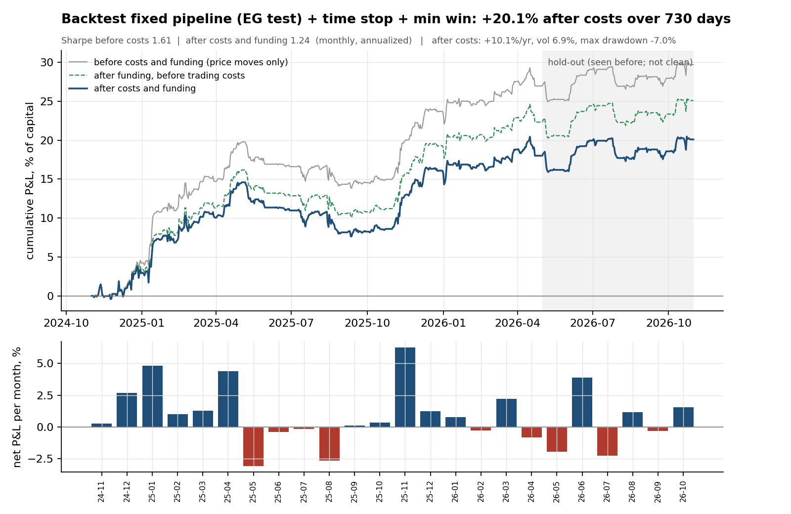
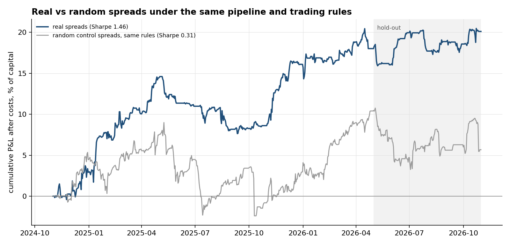

# Crypto cointegration stat arb on Binance perpetuals

A monthly, walk-forward pipeline that finds groups of Binance USDT-M perpetuals whose price gap keeps snapping back
(cointegration), and a backtest that trades those gaps after fees, slippage and funding.

## Results

Hourly data, Nov 2024 to Oct 2026, after all costs (fees, slippage, funding):

| Period | Return | Sharpe (daily, annualized) | Max drawdown |
| --- | --- | --- | --- |
| Development (Nov 2024 - Apr 2026) | +18.0% | 1.66 | -7.0% |
| Hold-out (May - Oct 2026) | +2.1% | 0.74 | -3.0% |
| All 24 months | +20.1% | 1.46 | -7.0% |
| Same rules on random control spreads | +5.7% | 0.31 | -11.4% |





## Pipeline (re-run every month)

| Step | Script | What it does |
| --- | --- | --- |
| 1 | `scripts/pull_data.py` | Hourly candles from Binance's bulk history files, coin facts and CoinGecko categories |
| 2 | `scripts/universe.py` | Coin list per month: no index contracts or stablecoins, listed at least 1 year, traded in at least 90% of hours, median daily volume at least $3M (measured on the 30 days before the month) |
| 3 | `scripts/clean.py` | Blanks no-trade hours and price spikes, fills gaps up to 24 hours, keeps coins with at least 95% clean hours |
| 4 | `scripts/candidates.py` | Up to 300 pairs, 100 baskets and 100 coin-vs-sector spreads with an economic link (same category or chain), log-price correlation >= 0.9 and market-removed correlation >= 0.2, plus the same number of random control spreads |
| 5 | `scripts/cointegration.py` | Johansen trace test on 90 days of hourly prices, confirmed by the Engle-Granger / MacKinnon cointegration test (p < 0.05) |
| 6 | `scripts/vecm.py` | VECM half-life; keeps half-lives of 6-240 hours and swings at least 3x the round-trip cost |
| 7 | `scripts/pull_funding.py` | Funding payments for every coin-month in the coin lists |
| 8 | `scripts/persistence.py` | The month after: does each relationship still hold, real vs random |
| 9 | `scripts/high_low.py` | Hourly highs and lows for the maker fill model |
| 10 | `scripts/backtest.py` | The strategy below, real and random spreads; tables, daily P&L and charts in `results/backtest/` |

## Strategy (`src/noisefinder/backtest.py`)

- Each month, trade the 20 spreads with the fastest half-life.
- Hedge ratio from a Kalman filter (30-day warm-up), locked when a trade opens.
- Bands: mean and standard deviation of the spread over the previous 10 days.
- Enter at 3 sigma, exit at the mean, stop at 5 sigma; time stop at 3x the spread's half-life.
- Skip trades whose expected win (a 3-sigma move, net of maker costs) is below 1.75%.
- Maker limit orders, filled only if the next hour trades 2 bp through the price; otherwise taker.
- No new entries in the last 3 days of a month; 1/20 of capital per spread.
- Costs: 5 bp taker / 2 bp maker fees, 2-10 bp slippage by liquidity tier, hourly funding.

## Testing design and bias controls

| Item | How it is handled |
| --- | --- |
| Walk-forward | Each month's spreads are picked from the 90 days before it and traded only in that month |
| Look-ahead | Hedge, bands and filters use past data only; fills happen in the next hour; coin lists and slippage tiers use the 30 days before each month |
| Survivorship | Coin lists are rebuilt monthly from what was tradeable then, delisted coins included |
| Random controls | Random spreads go through the same tests and trading rules as a benchmark |
| Multiple testing | Cointegration uses critical values for estimated weights (Engle-Granger / MacKinnon); random spreads pass 9% |
| Lucky-spread bias | Fixed 1/20 of capital per spread, no extra weight to spreads that looked best in-sample |
| Data snooping | Each change was fixed before it was tested and kept only if it won in both halves of development; all trials counted |
| Costs | Fees, slippage by volume tier and hourly funding on every trade |

Samples: development (in-sample for design choices) Nov 2024 - Apr 2026; hold-out May - Oct 2026; next clean
out-of-sample test is paper trading from Nov 2026 with the rules frozen.

Known limits: the hold-out has been looked at more than once, so it is not a fully clean test; CoinGecko categories
are current labels applied to past months; maker fills ignore queue position; 24 months cover one market regime.

## Setup

Python 3.10+. Create `.env` with `COINGECKO_API_KEY=...` and `COINGECKO_PLAN=pro`, then:

```
bash run.sh
```

`run.sh` creates a virtual environment, installs the package and runs steps 1-10. Settings are in
`src/noisefinder/config.py`; strategy settings are at the top of `src/noisefinder/backtest.py`.
